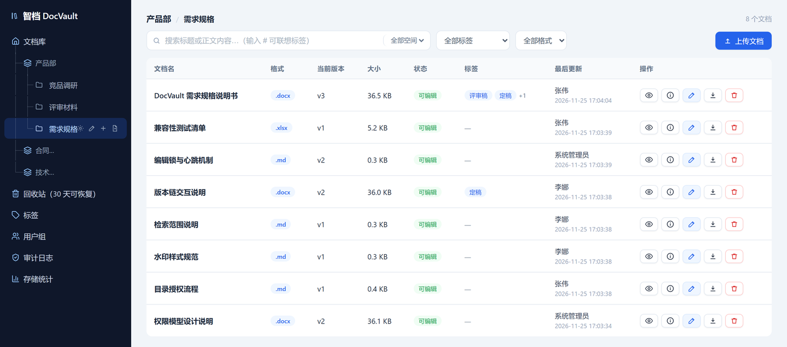
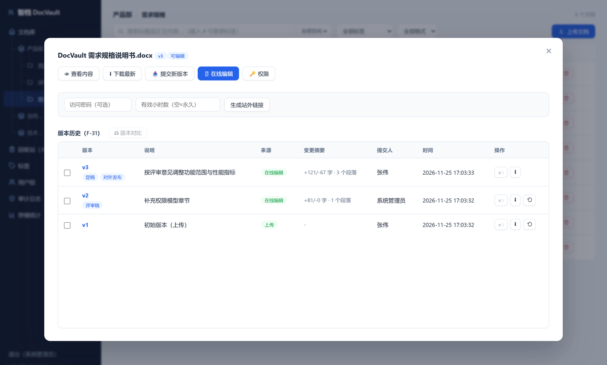
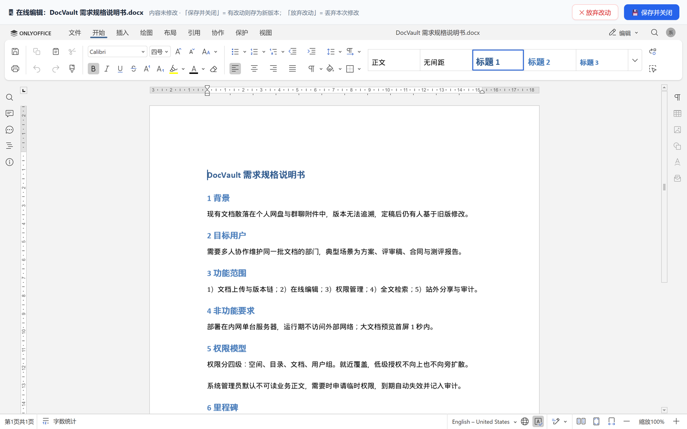
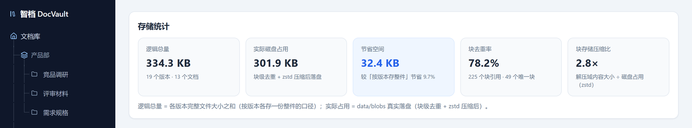

# 智档 DocVault

**私有部署的文档管理系统** · 版本溯源 · 在线协同 · 全程审计


[](https://github.com/amysonwu/docvault/actions/workflows/regression.yml)

[快速开始](#快速开始) · [功能](#功能) · [界面](#界面) · [隐私与合规](#为什么数据不出内网) · [路线图](docs/ROADMAP.md) · [架构](#架构) · [支持](SUPPORT.md)

---

企业里最难管的常常不是数据库，是那些还没定稿的 Word：方案、评审稿、合同、测评报告。它们一般散在三个地方：个人网盘，人走了就找不到；群聊附件，版本满天飞；SaaS 文档，数据出了内网，审计说不清。

DocVault 管三件事：记住每份文档的前世今生，谁改的、改了什么、能退回哪一版；按内容里的一个片段，把散在各处的文档找出来；再把谁能编辑、谁只能阅读安排清楚。

| 传统做法                     | 问题                  | DocVault            |
| ------------------------ | ------------------- | ------------------- |
| 共享盘 + `最终版-真的最终版.docx`   | 无版本链、无法回溯、改了谁不知道    | 每次保存自动生成新版本，可对比、可回滚 |
| 公有云 SaaS 文档              | 数据出内网，等保 / 密评难通过    | 一台内网服务器即可运行，运行期零外联  |
| 只买 OnlyOffice / WPS 在线编辑 | 有编辑没治理：权限、审计、版本全靠人管 | 编辑只是能力之一，治理是内核      |
| 自研 OA 附件模块               | 半年做完，第二年没人维护        | 开源，代码可读、可改、可自建      |

部署在你自己的服务器上，数据不出网。

检索靠 MySQL ngram 全文索引，文件名、标题、正文一起匹配，可以跨空间；标签用 `#` 单独查。

权限在检索链路里就过滤掉，目录级不可见的文档在 SQL 层就排除了，文档级再校验一次，搜不到就是你真的没权限看。

## 功能

### 文档与版本

- 内容寻址存储（CAS）+ 块级去重：文档按部件/块指纹落盘并以 zstd 压缩存储，真实编辑过的版本只存变化块（实测改一段文字的新版本磁盘增量 <5%）；管理后台可查去重率
- 完整版本链：上传、在线编辑、回滚、离线回传，每次都留痕并标注来源与提交人
- 版本对比：任意两个版本做结构化 diff（段落 / 表格 / 单元格级），输出增删字数与样式变动
- 版本标签：给某个具体版本打标签（如 `对外发布`、`评审稿`），一个版本可多标签，可按标签反查所有历史版本
- 版本回滚：回滚 = 以历史内容生成新版本，历史永不丢失

### 在线协同

- OnlyOffice 集成：docx / xlsx / pptx 浏览器内编辑，版式与本地 Office 一致
- 保真预览：服务端转 PDF，浏览器原生渲染，附动态水印（观看人、观看时间）
- md / txt 分栏编辑：左侧写、右侧实时预览，滚动联动
- 编辑锁 + 心跳续期：避免互相覆盖，异常断线自动释放

### 权限

- 四级主体：系统管理员 / 空间成员（管理员、内容操作员、读者）/ 目录受邀者 / 文档受邀者
- 就近覆盖：文档 > 目录 > 空间；低级授权不向上、不向旁扩散
- 用户组（组织树）：授权给部门，子部门自动继承；人员变动只改组，不用逐份改权限
- 私有目录：未受邀者看不到目录的存在
- JIT 临时提权：系统管理员默认看不到业务正文，需要时申请 2 小时权限，到期自动失效并写审计
- 防提权：任何授权都不能超过授权人自己在该对象上的权限

### 全域检索

- 一个搜索框搜全部：文件名（含扩展名）、标题、正文一起匹配，不用先想好去哪个空间找
- 中文全文检索：MySQL ngram 全文索引，长词走索引，单字自动降级为 LIKE 兜底
- 跨空间检索：范围可选「全部空间」或「当前空间」，结果只返回你有权限读的内容
- 标签即检索：输入 `#` 联想标签库，回车列出打了该标签的所有历史版本
- 格式过滤：按 docx / xlsx / pptx / PDF / 文本筛

### 治理与合规

- 全链路审计：登录、上传、编辑、授权、提权、删除、回滚、分享，逐条可查
- 站外分享：密码 + 有效期 + 仅预览，链接可随时失效
- 回收站：30 天可恢复，删除是软删除
- 离线回传比对：文件带出内网改完传回，自动与基线 diff，只提交差异说明
- 存储统计：逻辑容量与磁盘实际占用对照，去重收益可查

## 界面

截图取自本地实例，内容为演示数据。

**文档列表**：左侧按空间和目录组织，列表直接给出当前版本、可编辑状态、版本标签和最后更新人。



**版本历史**：每个版本都有来源（上传 / 在线编辑）、变更摘要（增删字数与段落数）、提交人与标签。勾选任意两版即可对比。



**在线编辑**：docx / xlsx / pptx 在浏览器内编辑，版式与本地 Office 一致，保存即生成新版本。



**存储统计**：逻辑容量与实际磁盘占用对照，块级去重和压缩到底省了多少，一眼能看到。



## 快速开始

```bash
git clone https://github.com/amysonwu/docvault.git
cd docvault/deploy
cp .env.example .env          # 改数据库密码与 JWT 密钥
docker compose up -d --build
```

打开 `http://<你的服务器>:10001`，第一个注册的账号自动成为系统管理员。

> 首登后请立刻改密码，并把 `.env` 里的 `JWT_SECRET` 换成随机串（`openssl rand -hex 32`）。

**这套编排里都有什么**

| 服务     | 作用                                    | 端口        |
| ------ | ------------------------------------- | --------- |
| `app`  | FastAPI 主服务                           | 8000（内部）  |
| `db`   | MySQL 8 兼容库（GreatSQL）                 | 3306（内部）  |
| `oo`   | OnlyOffice Document Server（在线编辑 / 转换） | 80（内部）    |
| `edge` | Nginx 边缘：静态资源 + 同源代理（免 CORS）          | 10001（对外） |

资源建议：2 vCPU / 4 GB 内存起（OnlyOffice 占大头）；不装在线编辑、只要版本管理与预览时，1 vCPU / 1 GB 足够。

**离线 / 内网环境安装**

1. 有网机器上 `docker compose build` 后 `docker save` 导出镜像；
2. 拷贝 tar 到内网机 `docker load`；
3. 前端静态依赖（Vue、PDF.js、图标）全部内置在仓库，运行期不请求任何 CDN；
4. 用 OnlyOffice 时需预置中文字体（见 `deploy/README.md`），否则中文会回退字形。

自检：`docker compose exec edge wget -qO- http://app:8000/api/health`。

## 为什么数据不出内网

| 约束     | 实现                                                       |
| ------ | -------------------------------------------------------- |
| 无外呼    | 前端依赖全部本地化（Vue / PDF.js / 图标均为仓库内文件），运行期无第三方请求            |
| 无遥测    | 没有埋点、没有版本上报、没有"匿名统计"开关                                   |
| 存储自持   | 文件落在 `data/blobs`（可挂 NAS / 本地盘），元数据在你自己的 MySQL           |
| 权限默认收紧 | 系统管理员默认看不到正文，需 JIT 提权；私有目录对未受邀者完全隐身                      |
| 可审计    | 谁在何时看了哪份文档的哪个版本，都有记录（含水印信息）                              |
| 可替换    | 存储层是接口（`StorageBackend`），换 MinIO / S3 不改业务代码；认证计划支持 OIDC |

拔掉外网它仍然完整可用，在线编辑用的也是内网自建的 OnlyOffice。做密评 / 等保时，这几条通常直接决定能不能进。

## 架构

```
                     ┌──────────────────────────────────────────┐
 浏览器 ─────────────▶│  edge (Nginx)  :10001                    │
 (Vue 3 单页)         │  · 静态资源 / 同源代理 / 上传大小限制      │
                     └───────┬──────────────────┬───────────────┘
                             │ /api/*           │ /oo/*  /cache/*
                   ┌─────────▼─────────┐   ┌────▼───────────────┐
                   │ app (FastAPI)     │   │ oo (OnlyOffice DS) │
                   │ · 权限内核 authz  │◀──│ · 在线编辑          │
                   │ · 版本链 / diff   │   │ · docx→pdf 转换     │
                   │ · 审计 / 分享     │   └────────────────────┘
                   └────┬─────────┬────┘
                        │        │
            ┌───────────▼──┐  ┌───▼───────────────────┐
            │ db (MySQL 8) │  │ data/blobs (CAS 磁盘) │
            │ 元数据/全文索引│  │ ab/cd/<sha256>      │
            └──────────────┘  └───────────────────────┘
```

技术栈：Python 3.13 · FastAPI · SQLAlchemy 2 · MySQL 8（ngram 全文）· Vue 3 · OnlyOffice · Nginx · Docker Compose。没有 Redis、消息队列、K8s，一台机器一条 `compose up`。

核心模块：

| 路径                       | 职责                                            |
| ------------------------ | --------------------------------------------- |
| `app/authz.py`           | 权限内核：就近覆盖、组授权、JIT、可见性过滤                       |
| `app/version_service.py` | 版本链、CAS 写入、变更摘要                               |
| `app/diffing.py`         | docx / xlsx / pptx 结构化对比                      |
| `app/storage.py`         | 存储接口 + 磁盘 CAS 实现                              |
| `app/routers/*`          | REST 接口（文档 / 版本 / 权限 / 组 / 标签 / 分享 / 离线 / 审计） |
| `web/`                   | 单页前端（Vue 3 全局构建，零打包工具，改完即生效）                  |

## 路线图

v0.2 打地基，v0.3 做编辑与阅读的本地 AI，v0.4 做知识库与文档加工，v1.0 面向企业环境。详细规划在 [docs/ROADMAP.md](docs/ROADMAP.md)。

**v0.2 工程化**：Alembic 迁移、存储完整性巡检（对账数据库与磁盘块）、MinIO / S3 后端、预览加速、OpenAPI 与访问令牌、移动端

**v0.3 编辑侧 AI（可完全离线）**

- 在线编辑侧栏：选中段落 → 续写 / 改写 / 精简 / 转正式语气，建议确认后才写入
- 打开即摘要：长文档生成要点卡片与风险提示
- 全部走 Ollama / vLLM 本地推理，不外发请求

**v0.4 知识库与加工**

- 全文问答：基于文档库的 RAG 检索，回答带原文出处
- 文档库索引为知识库（分块 + 向量化，向量库为可选本地组件，未部署时降级为关键词检索）
- 基于既有文档快速加工新文档：选几份周报生成月度总结、选两份方案融合成评审稿
- 模板引擎：常用公文骨架做成模板，填表即生成、自动套版式

**v1.0 企业级**

- SSO / OIDC / LDAP，组织架构自动同步
- 多副本与冷备，备份恢复演练常态化
- 水印策略、下载审批、DLP 对接、电子签章对接
- 多租户与配额，租户级审计报表

## 参与贡献

- 报 Bug、提需求：[Issues](https://github.com/amysonwu/docvault/issues)
- 改代码：先看 [CONTRIBUTING.md](CONTRIBUTING.md)，里面有 DCO 签署和测试约定
- 安全问题：不要开公开 Issue，按 [SECURITY.md](SECURITY.md) 报告
- 其他沟通方式和响应预期见 [SUPPORT.md](SUPPORT.md)

回归脚本（Python + requests，直接打 HTTP 接口）：

```bash
python scripts/perm_test.py  http://127.0.0.1:10001   # 权限矩阵 22 项
python scripts/group_test.py http://127.0.0.1:10001   # 用户组   27 项
python scripts/tag_test.py   http://127.0.0.1:10001   # 版本标签 20 项
```

## 商业支持与定制

项目本身免费（AGPL），可定制开发和商业授权，用来养这个项目的维护时间。

能做的：按你的业务加功能、私有化适配（单点登录、对象存储、老系统对接）、性能调优、升级与迁移协助、团队培训。不做的：驻场、紧急救火、代运维。

流程和边界写在 [COMMERCIAL.md](COMMERCIAL.md)。有兴趣就在 Issues 开一个标题带 `[商业]` 的议题，说明场景和大致范围，细节确认后再走合同。

## 许可证

- 主体代码：[AGPL-3.0-or-later](LICENSE)。可自由使用、修改、分发；若作为网络服务对外提供，须公开修改后的源码
- 商业授权（闭源集成 / 免除 AGPL 义务 / OEM 分发）：见 [COMMERCIAL.md](COMMERCIAL.md) 与 [docs/LICENSE-FAQ.md](docs/LICENSE-FAQ.md)
- 第三方组件、商标：见 [NOTICE](NOTICE)、[THIRD\_PARTY.md](THIRD_PARTY.md)、[TRADEMARK.md](TRADEMARK.md)

为什么是 AGPL？文档系统天生是网络服务，AGPL 才能保证改动回到社区，同时不影响企业内部自用（内部使用不触发开源义务）。若你的组织无法接受 AGPL，[docs/LICENSE-FAQ.md](docs/LICENSE-FAQ.md) 写了换成 Apache-2.0 的具体做法。

## English

**DocVault** is a self-hosted document management platform: content-addressed storage, full version chain with structural diff & rollback, Git-style version tags, an enterprise permission kernel (space → folder → document, user groups, just-in-time elevation for admins), OnlyOffice-powered online editing, watermarked PDF preview, password-protected share links, and end-to-end audit logging.

Built for air-gapped and privacy-sensitive environments: **no telemetry, no CDN, no outbound calls at runtime** — a single `docker compose up` on your own server.

License: AGPL-3.0-or-later (commercial licensing available).
